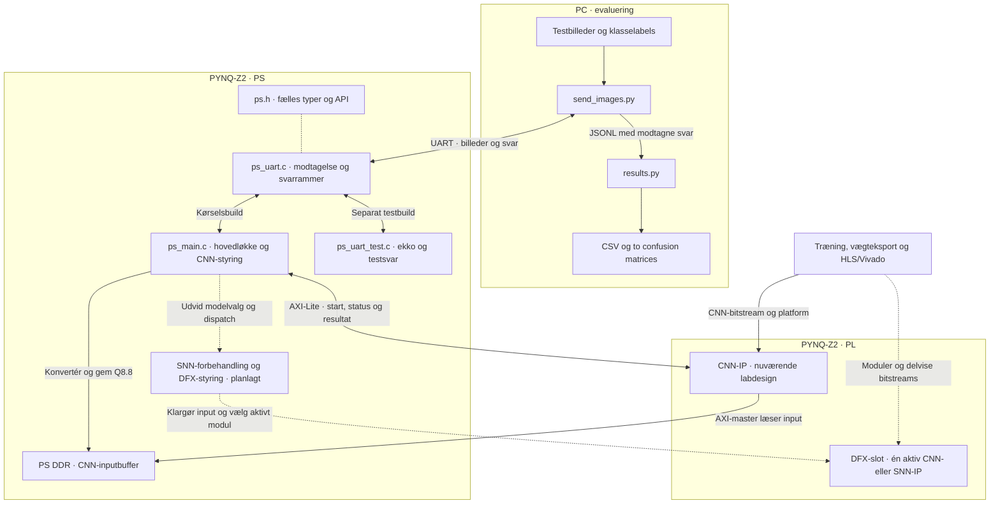
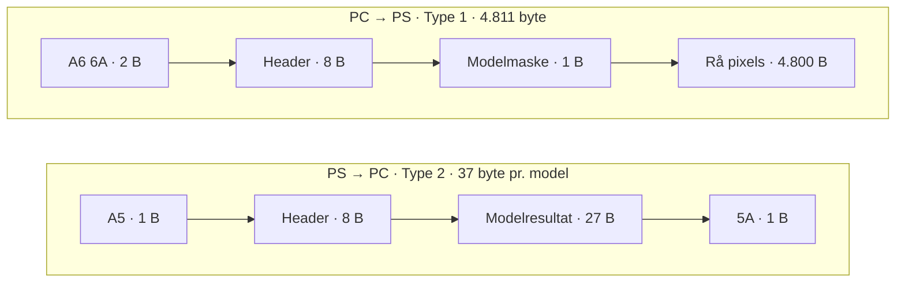
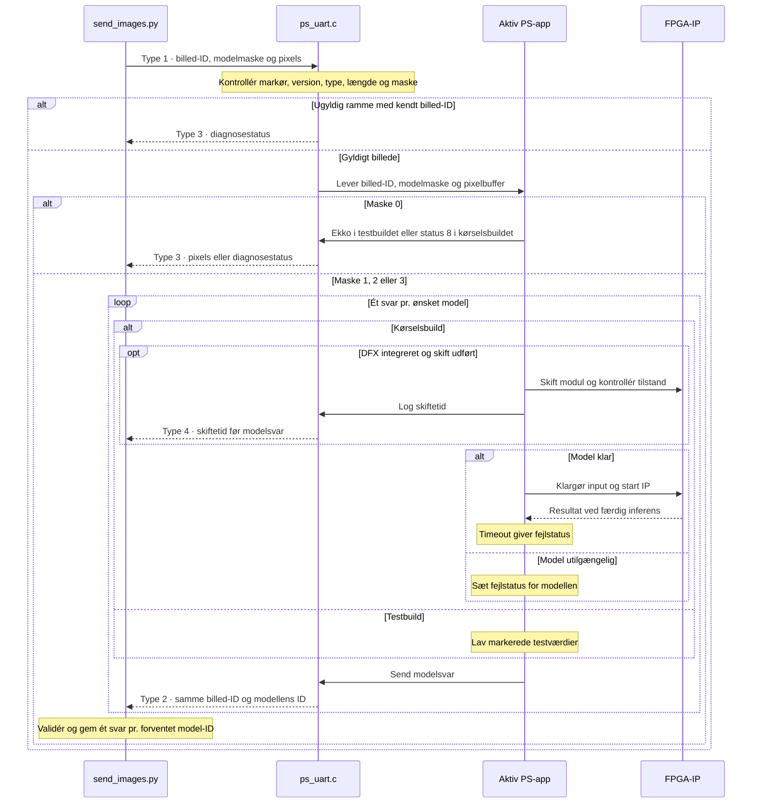

# System og UART · PYNQ-Z2

Diagrammerne følger den aktuelle `ps_uart_integration.zip`. UART-testen og et CNN-svar fra labbets accelerator er afprøvet på boardet. Stiplede forbindelser i systemdiagrammet viser integrationen af SNN og DFX.

## 1. Systemoverblik

- **Kørselsbuildet** består af `ps_main.c`, `ps_uart.c` og `ps.h`. PC’en sender de 4.800 rå gråtonepixels. PS’en opbevarer dem, mens CNN-grenen lægger et separat Q8.8-input i DDR, starter IP’en og henter resultatet.
- **Testbuildet** bruger `ps_uart_test.c` som indgangspunkt sammen med samme UART-modul og header. Det returnerer byte-ekko og markerede modelsvar. CNN-bitstream og formvægte hører til inferensforløbet.
- **Gruppens integration** tilføjer SNN’ens 384 features, dens accelerator og DFX-styringen ved modelvalget i `ps_main.c`. Den valgte SNN-inputbuffer og AXI-forbindelse afhænger af gruppens hardwaredesign. PC’en kan bruge den viste protokol i begge builds.

## 2. UART-rammer

Den fælles header er `body_length:u16 | version:u8 | type:u8 | image_id:u32`. Versionen er `1`. Længden tæller kun rammens body. Flerbytefelter er little-endian. Den opdaterede protokol bruger markører og længde til rammekontrol uden CRC.

| Type | Body i rækkefølge | Body | Hele rammen |
|---|---|---:|---:|
| **1 · Billede** | `model_mask:u8` → `pixels:u8[4800]` | 4.801 B | 4.811 B |
| **2 · Modelresultat** | `model_id:u8` → `status:u8` → `class_id:u8` → `infer_us:u32` → `prep_us:u32` → `scores:i32[4]` | 27 B | 37 B |
| **3 · Diagnose** | `status:u8` | 1 B | 11 B |
| **3 · Billedekko** | `status:u8=0` → `pixels:u8[4800]` | 4.801 B | 4.811 B |
| **4 · DFX-tid** | `model_id:u8` → `dfx_us:u32` | 5 B | 15 B |

På pc-siden vælger modelmasken `0` for testekko, `1` for CNN, `2` for SNN og `3` for begge. Modelsvar bruger model-ID `1` for CNN og `2` for SNN. Type 2-status `0` angiver et gyldigt resultat, `3` en utilgængelig model, `4` en inferensfejl og `128` et testsvar. Type 3 bruges blandt andet ved forkert længde (status `1`) eller ugyldig modelmaske (status `2`).

## 3. UART-protokol

PC’en holder én forespørgsel ad gangen åben ved **4 Mbaud, 8N1**. Med maske `3` hører to type 2-svar til samme billed-ID, og rækkefølgen kan skifte. PC’en tjekker startmarkør, header og slutmarkør, gemmer svarene i JSONL og går videre, når alle forventede model-ID’er er modtaget. Ved timeout rapporterer den de manglende svar.

Ved **UART-test** laver PC’en først to fejltests og kører derefter separat ekko og testmodelsvar for hvert billede. Ved **demo** bruger PC’en maske `3`, når begge modeller er integreret. Ved **benchmark** bruger den maske `1` og derefter `2` på samme testliste. Type 4 er beregnet til en særskilt måling pr. DFX-skift. De faktiske skift skal tilføjes af gruppen.
